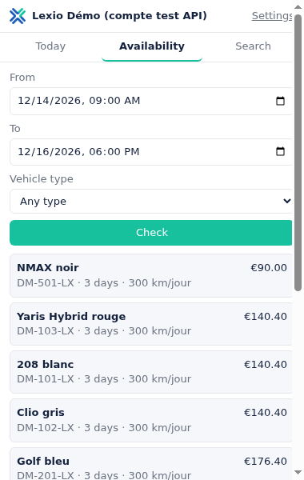

# Lexio Rent – Fleet & Bookings (browser extension)

A small Chrome / Edge / Opera / Brave extension for rental agencies that run on Lexio Rent. From the toolbar, without opening the back office:

- **Today**: the pick-ups and returns planned today, with vehicle, customer and times.
- **Availability**: which vehicles are free for any dates, sorted by price (tax included, with the default mileage package), filterable by vehicle type.
- **Search**: a rental by its number, or a customer by email with their rentals.

<a href="https://lexio.rent/en/car-rental-software">Lexio Rent</a> is rental management software for professional car, van and two-wheeler rental companies: bookings, digital rental agreements, condition reports, deposits, maintenance and invoicing. The extension reads your own Lexio data through the public <a href="https://docs.lexio.rent">Lexio Rent API</a>.



## Install

From the store of your browser (links below once published), or unpacked:

1. Download the latest `lexio-browser-extension-*.zip` from [Releases](https://github.com/lexio-rent-git/lexio-browser-extension/releases) and unzip it, or clone this repository.
2. Open `chrome://extensions` (or `edge://extensions`, `opera://extensions`), turn on **Developer mode**, click **Load unpacked** and select the folder.

## Set up

1. In Lexio, go to **Settings › Developer › API tokens** and create a key. Read scopes are enough: `vehicles.read`, `offers.read`, `rentals.read`, `customers.read`. The API is part of the Business plan.
2. Click the extension icon, then **Settings**, paste the key (`lck_...`) and click **Save and test**. The extension shows the name of your organization when the key works.

The interface is in English, or in French when your browser is in French.

## Privacy

The key is stored only in your browser profile and sent only to `api.lexio.rent`. The extension has no analytics, reads no web pages and uses only the `storage` permission. See [PRIVACY.md](PRIVACY.md).

## Development

Plain JavaScript modules, no build step, no dependency.

```sh
npm test                # unit tests (Node 20+)
npm run package         # builds dist/lexio-browser-extension-<version>.zip for the stores
```

`src/api.js` is a minimal read-only client of the Lexio API (cursor pagination, problem+json errors); `src/popup.js` and `src/options.js` are the two pages.

## About

Built and maintained by the team behind <a href="https://lexio.rent/en/car-rental-software">Lexio Rent, car rental software</a>. Agencies that still check vehicles on paper can start with the free <a href="https://lexio.rent/en/tools/vehicle-inspection-form-template">vehicle inspection form template</a>.

- API documentation: <https://docs.lexio.rent>
- Contact: contact@lexio.rent

License: MIT.
